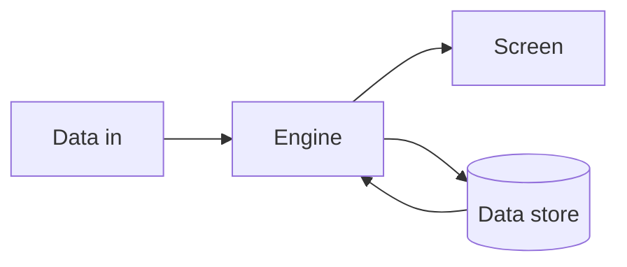

# Architecture

## One picture

## Components and why we chose them
| Component | What it does | Why this choice | File(s) |
|---|---|---|---|
| Data in | <where real data enters and how it is validated> | | |
| Engine | <request routing, business logic, LLM call> | <why this framework> | |
| Screen | <what the user sees and interacts with> | <why this stack> | |
| Data store | <what is persisted and why> | | |

## Data flow
<request -> lookup -> model -> verification -> response; where each number on screen comes from>

## What keeps it honest
- Every displayed number traces to a row (link the query).
- The LLM step returns structured output validated before display; failures show "no data".
- Tests: `pytest -q` (unit) and `/root/hack/bin/smoke.py <url>` (deployed page).

## What breaks first at scale
<name the single most likely failure point -- the queue, the token budget, the API rate limit, the data freshness
lag -- and what you would do about it with one more week. One real weakness named here raises credibility.>

## What we would change with a week
- <bullet 1>
- <bullet 2>
- <bullet 3>
