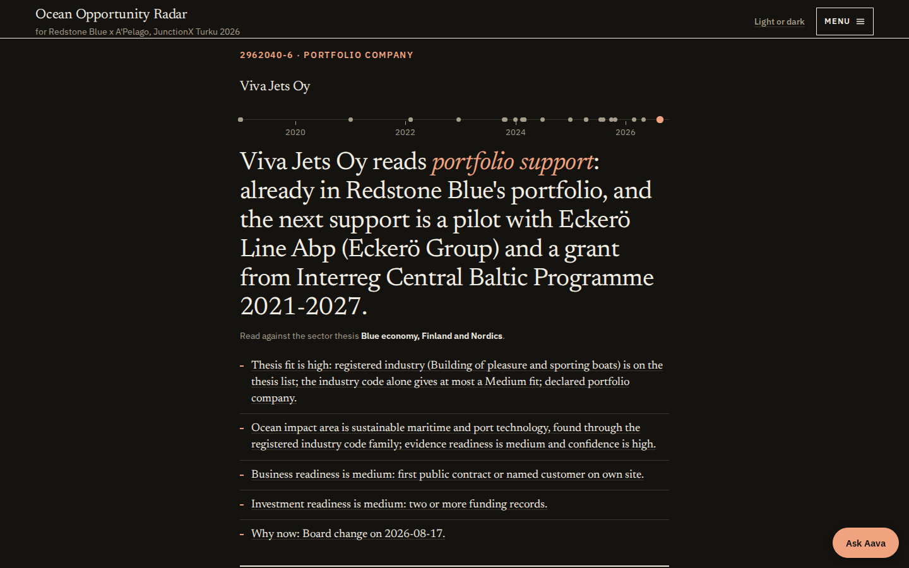

# Ocean Opportunity Radar: decision-ready venture intelligence for the European Tech Renaissance (Redstone x A'Pelago)

Every rule and dated decision behind these numbers: [PROJECT_RULES.md](PROJECT_RULES.md) (assumptions, decisions, taxonomy, formats; it folds in ASSUMPTIONS.md with the same ids).

Ocean Opportunity Radar finds young blue-economy companies in public records before they reach a fund's or an accelerator's
pipeline, and answers the partners' four questions about each one with a source link under every fact.
Built at JunctionX Turku 2026 for the Redstone x A'Pelago challenge by team Old Hackers.

**Live:** <https://jx.hankintaviikko.fi>



## 30 seconds

**The problem, in the partners' words.** "Find promising startups as early as possible" and turn "fragmented startup and
ecosystem data into decision-ready venture intelligence".

**Who it is for.** The investment team at Redstone Blue (pre-seed and seed) and the programme team at A'Pelago, who screen
applicants for the Nordic Blue accelerator.

**What it does.** It reads Finnish and EU public records (trade register, tax registers, register notices, public contracts,
EU projects, Business Finland funding), keeps one dated event per record with its link, and shows three screens:

1. **The home page** (`/`): one list of companies, each row showing the name, the registered line of business, a life-line of
   dated public records and the memo's verdict, in three tabs (All startups, Top fits, New this quarter) under a headline count of
   companies that surfaced in the last 90 days. Every row opens its company page; the folded section "All public records in the
   window, weak matches and the rules" lists each record with what was found, when, why it fits the sector, how sure we are and
   the link to the record.
2. **The company page** (`/c/{company key}`, the business ID for a Finnish company): a memo for the fund (one decision from the team's decision table), then the four
   questions in the partners' order: 01 Who is most promising, 02 How ready are they, 03 Who comes next, 04 What should happen next.
   Every level prints its rule and its evidence.
3. **The Nordic Blue 19** (`/radar`) and the **earliness test** (`/backtest`): the 19 Nordic Blue 2026 cohort companies and the
   9 Redstone portfolio companies, and the test of whether the radar would have shown the cohort before it entered the programme.

**The measured result.** Applying its own feed rule to live public records, the radar would have shown **0 of the 19** cohort
companies before January 2026. With declared research added, 12 of 19 have a counted public
signal before that date. The reason the number is low is the finding: of the 7 cohort companies
with a Finnish business ID, none is registered under an industry code on the sector list. They are registered as software,
retail, wholesale, consulting, R&D and freshwater aquaculture. Method and every caveat: [EVAL.md](EVAL.md).
The wide intake (it takes startup-shaped companies in before any sector test) held 4 of those 7 before January 2026: Kilocode,
Sireness, Arctic Fry and Emission-Eye. That is less than it sounds: Kilocode's intake date is a 2003 VAT registration, Kilocode and
Arctic Fry are there only because we added their code families after seeing them (in-sample, labelled on `/backtest`), Sireness
enters on a declared-research record rather than a public one, and Emission-Eye, on a public start-up notice, ranks 132 of 1,176
among the 2025 registrations in its code family. The four, with their dates and ranks, are in [EVAL.md](EVAL.md), "Wide intake".
Corroboration rule (17 Oct): a sector word in a legal name is backed only by a record from a different source family, and PRH register
entries, PRH notices and PRH tax registers count as one registry; with that rule the live store shows 0 of 19 (the one hit was the word
"marin" plus a PRH tax-register record).
Decision fallback (17 Oct): when thesis fit is High on more than an industry code (a declared member, the source's own text, the registered line of business or a corroborated
name word) and there is no impact evidence, the memo reads impact as Medium, implied by the sector, and says so ("because: fallback c2, impact implied by sector"); the rule is printed on `/method`.

## The demo path (what to click)

1. Open <https://jx.hankintaviikko.fi>. The editorial home carries three different counts, so read the label beside each number
   (window 2026-07-19 to 2026-10-17, 90 days; the numbers below are the ones on the page and in `/api/feed` on 17 Oct 2026, and
   they move as the store is refreshed):
   - **Headline, "22 companies surfaced":** companies whose first public record falls inside the window. All 22 are among the 30
     strong-tier companies; none of the declared cohort or portfolio companies has its first record in the window.
   - **Tabs, "All startups 58", "Top fits 31", "New this quarter 22":** the home list. 58 is the 30 strong-tier companies (found with a
     stated reason: industry code, line of business, the source's own text or a corroborated name) plus the 28 declared cohort and
     portfolio companies (19 + 9). Top fits 31 are those whose memo verdict is Invest, Due diligence or Accelerator, or whose thesis
     fit is High. New this quarter 22 is the headline's 22.
   - **Folded section "All public records in the window, weak matches and the rules":** the full feed window list, 122 companies
     (279 signals) on their first counted signal in the window: 30 strong (the same 30) and 92 weak. The weak ones stay in a closed
     list because the stored record gives no sector reason the rule accepts ([PROJECT_RULES.md](PROJECT_RULES.md), A5). Here every
     row names its source (for example PRH/YTJ tax registers or the PRH notices API), links to the record and carries a "How sure"
     line.
2. Press `/` (it opens the folded section and focuses **Find a startup**) and type `Arctic Fry`, or click Arctic Fry Oy in the
   list. It opens <https://jx.hankintaviikko.fi/c/3166759-6>, Arctic Fry Oy, a Nordic Blue
   2026 cohort company. The memo reads WATCHLIST, because Ocean impact Medium, Business readiness Low, Investment readiness
   unknown and Thesis fit Medium, and it names the evidence still missing. The life-line shows its first public trace:
   first sales on 2020-10-05 (VAT register), first hire on 2025-04-01 (employer register).
3. Read the four questions on the same page. 01 says "Thesis fit: declared cohort company" (it was selected into the programme;
   no industry code, line of business or source text shows the fit on its own yet). 02 gives Business readiness 2 of 9 with the KTH rule printed under it, and "no public evidence" for technology and
   investment. 03 lists investors, programmes and partners from the declared ecosystem dataset, each with its reason, plus the
   BlueInvest E-Pitching session that closes 2026-11-12. 04 says Watch, names the rule used (5) and prints the whole decision table.
4. Open a portfolio company for contrast: <https://jx.hankintaviikko.fi/c/2962040-6>, Viva Jets Oy. Its industry code 30120
   (building of pleasure and sporting boats) is on the sector list, and the page shows share issues from the PRH register
   notices and Business Finland funding in 2019, 2021 and 2024. Its memo reads ACCELERATOR, "because: fallback c2, impact implied
   by sector": thesis fit High from the industry code, no published impact, business and investment readiness Medium.
5. Click **The Nordic Blue 19** (`/radar`): the 19 cohort and 9 portfolio companies, each with its count of dated public records
   and a timeline. Companies with no public event are listed apart as "no public events", never filled in.
6. Click **Earliness test** (`/backtest`): the four groups (found earlier by live public records, found earlier only by declared
   research, found later, no public signal), the chart of first signal against the reference date, the rule in full, the wide
   intake table, and the AI stitcher line, which is counted apart and never added to the groups.
7. Swap the sector: <https://jx.hankintaviikko.fi/?thesis=health_tech_turku>. Same code, a different thesis file, and a thin demo.
   Read the measure beside each number: the headline says "1 company surfaced" (the headline measure, first public record inside the
   window) and the home list holds that 1 company, KE Pharma Oy, registered under retail sale of medical and orthopaedic goods. The
   folded "All public records in the window" section lists 30 companies, 1 strong and 29 weak, and many of the weak ones are not
   health companies (for example two "auto care" firms matched on the word "care"). It shows that the sector swap works; it is not an
   evaluated health thesis.
   A third file, `baltic_blue`, widens the blue-economy thesis to the Baltic Sea countries; it is not part of the demo path.
8. Click **Data** (`/data`): every source, company and dated record in the database (17,193 companies and 47,693 dated records), each with its link.

Data page: /data shows every source, company and dated record in the database; the Refresh button re-reads the register notices on a copy and swaps it in only if it checks out. The button is switched off unless the service environment sets `REFRESH_ENABLED=1`.

The same data is served as read-only JSON at <https://jx.hankintaviikko.fi/api> (company search, company, feed, backtest).

Ask Aava (demo flag `?demo=1`, remembered on that device; `?demo=0` turns it off) narrates a page from its own records. Only two things have a recorded voice: the Viva Jets Oy company page (40 clips) and the home feed reader (5 clips), 45 MP3 files and 6,913 characters in `radar/static/aava/audio/`, rendered once with ElevenLabs text-to-speech (model `eleven_multilingual_v2`, premade voice Lily, voice id `pFZP5JQG7iQjIQuC4Bku`; the code's default voice is `21m00Tcm4TlvDq8ikWAM`, so the render sets `ELEVENLABS_VOICE_ID`). Every other page, Arctic Fry Oy included, has no recording and is read by the browser's own voice; the player also falls back to the browser voice when a clip is missing or the page text has changed. The recorded pages play files with no network call and no key at runtime. To render again: `ELEVENLABS_API_KEY=... ELEVENLABS_VOICE_ID=pFZP5JQG7iQjIQuC4Bku python3 -m radar.aava_voice render --keys 2962040-6 --feed`.

## Run it in 3 commands

From the repository root, with Python 3.12:

```bash
pip install -r requirements.txt
python3 -m radar.build
python3 -m uvicorn app:app --port 8130     # open http://127.0.0.1:8130
```

`python3 -m radar.build` runs every adapter in `radar/adapters/` and writes `data/radar_redstone_apelago_blue.sqlite`. The network
adapters read public APIs at one request every 2 seconds and cache what they read under `data/cache/`, so the first full build is
slow (the wide intake pass alone made 616 requests in its run on a store copy). Two quicker ways, both checked in a fresh clone on 17 Oct:

- Offline, in under 10 seconds (8.4 s on 17 Oct, on a busy host): `python3 -m radar.build --adapters declared,businessfinland,ecosystem` loads the 28 declared
  companies, the Business Finland export and the declared ecosystem dataset (147 signals), and every page renders.
- The committed snapshot of 16 Oct, about 21:40 UTC: `RADAR_DATA_DIR=data/snapshot python3 -m uvicorn app:app --port 8130`. Its
  numbers are older than the live site's.

Second thesis: `python3 -m radar.build --thesis config/thesis_health_turku.yaml`. Tests: `python3 -m pytest -q` (590 passed on 17 Oct, in 304 s on a busy host).

Combined database (team only): `python3 -m radar.combined --thesis redstone_apelago_blue` writes `data/combined/redstone_apelago_blue_combined.sqlite`, the declared ecosystem file unchanged plus the radar's public-record tables (`radar_*`) and the view `v_entity_public_record`; it carries the dataset's `person` table, so it is not for publication.

## Sources

| Source | What it gives | Adapter |
|---|---|---|
| PRH/YTJ open data API v3 (Finnish trade register) | company facts and the register entry date | `prh.py` |
| PRH/YTJ registered entries (tax registers) | first sales (VAT or prepayment register) and first hire (employer register) dates | `tax_registers.py` |
| PRH registered notices API v3 | share issues, board changes, start-up notices, capital losses, each dated | `prh_notices.py` |
| PRH/YTJ wide intake | startup-shaped limited companies and cooperatives, taken in before any sector test | `prh_intake.py` (in the live store since 17 Oct (16,385 prh_intake signals)) |
| Hilma public procurement awards | a young company's first public contract in the sector's categories | `hilma.py` |
| CORDIS (Horizon Europe and H2020) | EU project participation, start date and EU contribution | `cordis.py` |
| Business Finland funding export | funding decisions, year only (the dashboard export has no decision date) | `businessfinland.py` |
| BlueInvest project pipeline | public profiles with TRL; a dated signal only when a page states a listing date | `blueinvest.py` |
| OpenAlex | research output whose author affiliation names the company | `openalex.py` |
| Internet Archive (Wayback CDX) | first archived capture of a company's site and milestone pages | `webarchive.py` (not in the live store yet) |
| TED contract award notices | EU-wide public contracts won | `ted.py` (not in the live store yet) |
| EU Funding and Tenders reference data | EU grants to Finnish beneficiaries | `eu_grants.py` (not in the live store yet) |
| Estonian e-Business Register | register entries of Estonian companies | `estonia_register.py` (not in the live store yet) |
| Declared lists in `data/declared/` | the 28 cohort and portfolio companies, investors, programmes, buyers, and the ecosystem dataset | `declared.py`, `ecosystem.py` |
| AI stitcher | dated events on public web pages, proposed by an LLM and kept only when plain code confirms them twice | `stitcher.py` (run by hand, not by the build) |

Licences, snapshot dates and the full list are in [DISCLOSURE.md](DISCLOSURE.md).

## Honesty lines

- **No scraping behind logins.** LinkedIn, Dealroom, Crunchbase, PitchBook and Tracxn appear only as connector slots marked
  "not connected". Nothing from them is in the repository or on the pages.
- **Companies only, by rule.** Legal names shaped like a private person's name are hidden, the stitcher builds its own queries from
  register facts only and redacts person-shaped names in the quotes it stores (and, since commit 431df23, in the LLM's logged
  queries), and the ecosystem dataset's people fields are not imported.
- **"No public evidence" is never a placeholder.** Empty is shown as empty with a hatched chip such as "not in public records".
  No level, date or number appears without the record behind it.
- **Declared research is labelled.** Events from the declared ecosystem dataset carry "declared research" and form their own group
  in the backtest. Stitcher events are counted apart and never added to the live count.

## Architecture

```
public sources --> radar/adapters/*.py --> radar/emit.py --> data/radar_{thesis id}.sqlite
                                                                  |
            store.py, fit.py, frameworks.py, earliness.py, matching.py, memo.py
                                                                  |
                        FastAPI + Jinja2 + htmx pages, JSON API at /api, Datasette (local only)
```

The sector rules (industry codes, keywords, intake families, the memo's decision table, the backtest population) sit in one thesis
file in `config/`, so a sector swap is one environment variable or one `?thesis=` parameter; the few sector words still in code are
named in ARCHITECTURE.md. Adapters and page routes are discovered by module, so parallel branches never edit a shared list. Full detail:
[ARCHITECTURE.md](ARCHITECTURE.md); the module map with commands to run each piece: [MODULES.md](MODULES.md).

## Documents

- [ARCHITECTURE.md](ARCHITECTURE.md): diagram, components and why each was chosen, what breaks first.
- [MODULES.md](MODULES.md): the four modules (data, API, matching, web) and how to run each alone.
- [EVAL.md](EVAL.md): the held-out set, the measured result and real failures.
- [METHOD.md](METHOD.md): how the AI stitcher searches, reads, dates and double-checks an event.
- [DISCLOSURE.md](DISCLOSURE.md): what we built this weekend and what we brought.
- [PILOT.md](PILOT.md): eight weeks with Redstone Blue and A'Pelago.
- [DEMO_SCRIPT.md](DEMO_SCRIPT.md): the table and stage demo.

## Team

Team Old Hackers. Dayo: demo, partner desks and the judged documents. Amir (GitHub amirhnourian): the agentic stitcher with
citations and the explainable match rules. AI coding sessions (Claude Code on our server and in the cloud) wrote code on branches
that we reviewed and merged; see [DISCLOSURE.md](DISCLOSURE.md).
