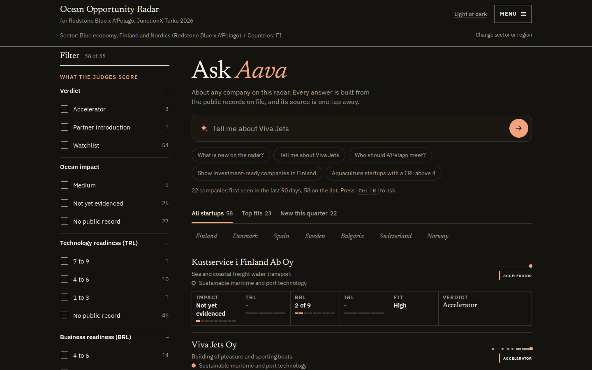

# Ocean Opportunity Radar: decision-ready venture intelligence for the European Tech Renaissance (Redstone x A'Pelago)

Every rule and dated decision behind these numbers: [PROJECT_RULES.md](PROJECT_RULES.md) (assumptions, decisions, taxonomy, formats; it folds in ASSUMPTIONS.md with the same ids). Every number in the judged documents, with the page or query it was read from: [docs/NUMBERS.md](docs/NUMBERS.md).

Ocean Opportunity Radar finds young blue-economy companies in public records before they reach a fund's or an accelerator's
pipeline, and answers the partners' four questions about each one with a source link under every fact.
Built at JunctionX Turku 2026 for the Redstone x A'Pelago challenge by team Old Hackers.

**Live:** <https://jx.hankintaviikko.fi>



## 30 seconds

**The problem, in the partners' words.** "Find promising startups as early as possible" and turn "fragmented startup and
ecosystem data into decision-ready venture intelligence".

**Who it is for.** The investment team at Redstone Blue (pre-seed and seed) and the programme team at A'Pelago, who screen
applicants for the Nordic Blue accelerator.

**What it does.** It reads Finnish and EU public records (trade register, tax registers, register notices, public contracts,
EU projects, Business Finland funding), keeps one dated event per record with its link, and puts every company through the
partners' four questions: 01 Who is most promising, 02 How ready are they, 03 Who comes next, 04 What should happen next. Five features carry it, named the way the judges score:

| Feature | Judge criterion | What it is, and where to see it |
|---|---|---|
| **Ocean Impact Assessment** on every blue company page | Creativity, precision | The impact area in words, the records that name it (each with a link), scalability from records only, an evidence-readiness ladder of 9 rungs and a confidence with its reason. A sector-implied rung reads "not yet evidenced", never Low. <https://jx.hankintaviikko.fi/c/2962040-6> |
| **Criteria box on every row and 12 filters** | Usability, precision | Each home row shows impact, TRL, BRL, IRL, thesis fit and verdict as the company page states them; the rail filters on all of them (and on country, sector, age, source, deadline, declared member); every view is a shareable URL, for example `/?verdict=ACCELERATOR`. <https://jx.hankintaviikko.fi/> |
| **Matchmaking**, `/match` | Actionability | Who is the next step for a startup, and which startups fit an investor, programme, funder or pilot partner: filter first, then rank, declared plus revealed demand, keywords from both sides, every reason in words with its record, no score. <https://jx.hankintaviikko.fi/match> |
| **Aava**, a six-question conversation, and the Ask Aava bar on the home page | Visual appeal, usability | The analyst speaks the page: "what do you think", "what is the official score", "how sure are you", "who should we meet", "what is the next move", "what would change your mind". Recorded voice (Rachel, ElevenLabs) for Viva Jets, Arctic Fry and the home "what is new" answer, the browser voice elsewhere. Behind `?demo=1`. |
| **The earliness test, a checked AI stitcher and one thesis file per sector** | Scalability, technical execution with data and AI | Applying our own feed rule to live records, would we have shown the 19 Nordic Blue companies before they entered? The AI only proposes, plain code decides, and a sector swap is one YAML file. <https://jx.hankintaviikko.fi/backtest> |

**Missing information is a finding, not a low score.** The sponsor's guidance (A'Pelago, 17 Oct): "missing information is not necessarily a reason to exclude a company or assign it a low score. Identifying information gaps, distinguishing facts from assumptions, and determining what to investigate next can itself be valuable venture intelligence." The product does exactly that, and says so on the page:

- **Not yet evidenced.** Ocean impact rungs 1 and 2 (the sector is implied by an industry code or a line of business, and no record names the area) carry no band: 26 of the 58 companies on the home list read "Not yet evidenced", and the filter rail counts them as their own group. Technology, business and investment levels with no record read "no public record", and the decision table cannot turn a missing level into REJECT / LOW FIT (A10, A12).
- **What is missing.** The company page prints a "What's missing" line, the verdict says "more public evidence needed: Investment readiness, Technology readiness", and Aava's sixth answer begins "What I am missing".
- **How sure.** Every ocean-impact level carries a confidence (high, medium, low) with the reason ("2 independent source families agree: PRH/YTJ register, Redstone Blue page"); every feed record carries a "How sure" line.
- **Facts versus assumptions.** "Impact implied by the sector" is printed whenever the memo's fallback reads impact as Medium; declared research is labelled as such and a low-confidence reading is "a lead and sets no rung"; the AI summary is a sentence-by-sentence extract of linked records, checked by code.
- **What would change my mind, and the record that would raise it.** Every ocean-impact level prints "To raise it" with the one record that would lift the rung (for Viva Jets: "A second independent source family that names the same area"); Aava's sixth answer says which verdict would follow ("at high it stays accelerator; at medium or low it drops to watchlist").

**The measured result.** Applying its own feed rule to live public records, the radar would have shown **0 of the 19** cohort
companies before January 2026. With declared research added, 12 of 19 have a counted public
signal before that date. The reason the number is low is the finding: of the 7 cohort companies
with a Finnish business ID, none is registered under an industry code on the sector list. They are registered as software,
retail, wholesale, consulting, R&D and freshwater aquaculture. Method and every caveat: [EVAL.md](EVAL.md).
The wide intake (it takes startup-shaped companies in before any sector test) held 4 of those 7 before January 2026 (Kilocode,
Sireness, Arctic Fry and Emission-Eye), and we claim less than that: Kilocode's intake date is a 2003 VAT registration, Kilocode and
Arctic Fry are there only because we added their code families after seeing them (in-sample, labelled on `/backtest`), Sireness
enters on a declared-research record rather than a public one, and Emission-Eye ranks 132 of 1,176 among the 2025 registrations in its
code family. Dates and ranks: [EVAL.md](EVAL.md), "Wide intake".

## The demo path (3 minutes, on the live site)

Full script with the lines to say: [DEMO_SCRIPT.md](DEMO_SCRIPT.md). The numbers below are the ones on the pages and in the JSON API on 17 Oct 2026 and move as the store is refreshed; each is read from the page or query named in [docs/NUMBERS.md](docs/NUMBERS.md).

1. **Home** <https://jx.hankintaviikko.fi>. The hero is the Ask Aava bar. Type "Tell me about Viva Jets" (or press one of its example questions). Under the bar a muted line reads "22 companies first seen in the last 90 days, 58 on the list", and the list carries 58 startups (the 30 found with a stated reason plus the 28 declared cohort and portfolio companies, 19 + 9); tabs All startups 58, Top fits 23, New this quarter 22.
2. **One filter click.** In the rail, "What the judges score", press Verdict, Accelerator: 3 of 58, and the URL `/?verdict=ACCELERATOR` is the view. Each row shows its criteria box.
3. **Viva Jets Oy**, <https://jx.hankintaviikko.fi/c/2962040-6> (`?demo=1` for Aava). Reads ACCELERATOR, "impact not yet measured". The Ocean Impact Assessment says: impact area sustainable maritime and port technology, found through industry code 30120; evidence records with links; level 5 of 9, Medium; confidence high because two source families agree; to raise it, a second independent source family naming the same area. Tap Aava's "How sure are you?" and "What would change your mind?".
4. **Arctic Fry Oy**, <https://jx.hankintaviikko.fi/c/3166759-6>. The honest miss and the honest gap: WATCHLIST, business readiness 2 of 9, technology and investment readiness "no public record", and Aava says which record would change the verdict.
5. **Match**, <https://jx.hankintaviikko.fi/match?org=apelago>. The startups that fit A'Pelago: its declared companies in our records first (20), then the best of the rest, each with reason chips and a sentence with the record behind it. From a startup the same view lists 56 counterparts for Viva Jets and 33 for Arctic Fry that pass the filters.
6. **Earliness test**, <https://jx.hankintaviikko.fi/backtest>: 0, 12, 6, 1 of 19, and the wide intake table with each rank beside its own pool.

## What each screen does

1. **The home page** (`/`): the **Ask Aava bar** (below), then one list of companies, each row showing the name, the registered line of business, the ocean impact area, a life-line of dated public records, the **criteria box** (impact, TRL, BRL, IRL, thesis fit, verdict, each "x of 9", a band or "no public record", with the source records in its tooltip) and the memo's verdict. Tabs: All startups, Top fits, New this quarter; country views; a **filter rail** with 12 filters in two groups ("What the judges score": verdict, ocean impact, TRL, BRL, IRL, thesis fit; "Narrow down": country, sector, registered age, source records, programme deadline, declared company). Choices inside one filter are alternatives, different filters all have to hold, and the number beside an option is how many startups would remain. The folded section "All public records in the window, weak matches and the rules" lists the 122 companies (30 main, 92 weak) with each record, why it fits the sector, how sure we are and the link.
2. **The company page** (`/c/{company key}`, the business ID for a Finnish company): the verdict and its reason in one sentence, the **Ocean Impact Assessment**, key statistics, an AI summary of the linked records (checked by code), **Who to meet** and **Next steps** (the matchmaking block), the news life-line, and the four questions in the partners' order with every level's rule and evidence printed.
3. **Match** (`/match`): a counterpart list (191 organisations: 57 investors, 16 accelerators, 11 grant or loan programmes, 32 public funders and foundations, 60 corporate or public buyers, 10 ports, 5 clusters) and a startup search. Method, practices adopted and rejected, and limits: [docs/MATCHING.md](docs/MATCHING.md).
4. **The Nordic Blue 19** (`/radar`) and the **earliness test** (`/backtest`): the 19 cohort companies and the 9 Redstone portfolio companies, and the test of whether the radar would have shown the cohort before it entered the programme.
5. **Menu** (top right, and the footer): the pages that used to be the header's tab row (New this quarter, The Nordic Blue 19, Match, Earliness test, Rules, Data). **Rules** (`/method`), **Data** (`/data`: 17,193 companies and 47,693 dated records, each with its link) and the read-only JSON API at <https://jx.hankintaviikko.fi/api> (company search, company with the Ocean Impact Assessment, feed, backtest, `/api/match/company/{key}`, `/api/match/org/{id}`, `/api/match/orgs`).

**Ocean Impact Assessment (rule D27).** Evidence readiness from public records, not a measure of true impact: the Ocean Impact Navigator publishes impact areas and KPIs but no levels, so the nine rungs are ours and each names the record that must be on file. 1 to 2 the sector is implied (industry-code family, registered line of business, a legal-name word backed by a second source family); 3 to 4 the source's own text names the area; 5 to 6 a second independent source family names it and a blue programme or portfolio page lists the company; 7 to 8 declared research holds an impact assessment or a quantified outcome with a stated method; 9 a measured outcome from an official or register source, which no connected source holds. Bands: levels 1 to 2 carry no band ("not yet evidenced"), 3 to 7 Medium, 8 to 9 High. On the 58 home rows: 3 companies reach a level (all 5 of 9, confidence high), 26 read "not yet evidenced" (25 at rung 1, 1 at rung 2), and the other 29 have no rung: 2 of them (Kelluu Oy, NIDO Contech) show only the Navigator category band "Medium" as a category match, and 27 read "No public record". The filter rail counts the same split: Medium 5, Not yet evidenced 26, No public record 27. No company reaches rung 6 or higher today. Ladder in full on `/method#ocean-impact`; method note in [METHOD.md](METHOD.md), section 7.


**Matchmaking (rules D28 to D30, A34).** For a startup: the investors, programmes, funders and pilot partners that fit its verdict path, the geography they declare and the readiness window they state (hard filters), with the same sector or impact area, shared words, lookalikes in the counterpart's declared cohort or portfolio and a deadline inside 90 days as reason chips. For a counterpart: the startups that fit it, its declared cohort first. Demand is **declared** (its own text, stages, geography, window) plus **revealed** (the companies it has chosen: 14 of the 191 organisations have declared companies in our records, 67 links); keywords are read on **both sides** (the counterpart's declared words and the startup's own text, through keyword groups from the thesis file and raw shared word stems); there is **no score** anywhere, and the API has no score field.

**Aava (no model).** Six questions per company page, each with one first-person answer built only from the rows the page shows; a fact the records lack is spoken as missing. The answers for Viva Jets Oy and Arctic Fry Oy, and the home page's one "what is new" answer, are pre-rendered at build time in the ElevenLabs voice Rachel (16 clips, 4,404 characters: 12 for the two companies and 4 for the feed answer; model `eleven_multilingual_v2`, in `radar/static/aava/audio/`), so those play files with no network call and no key at runtime. Every other company is read by the browser's own voice, and the player also falls back to it when a clip is missing or the page text has changed. Aava is hidden on the public site: `?demo=1` turns it on for that device (remembered), `?demo=0` turns it off. To render again: `ELEVENLABS_API_KEY=... python3 -m radar.aava_voice render --keys 2962040-6,3166759-6`.

**Ask Aava bar (live since 12:54 UTC on 17 Oct, merge 5cd3293).** The home hero is a bar: "Ask Aava. About any company on this radar. Every answer is built from the public records on file, and its source is one tap away." Type a question (Enter asks; Ctrl or Cmd K focuses the bar from anywhere on the home page) or press one of the five example questions ("What is new on the radar?", "Tell me about Viva Jets", "Who should A'Pelago meet?", "Show investment-ready companies in Finland", "Aquaculture startups with a TRL above 4"). A **deterministic intent router** at `GET /api/ask?q=` (`radar/ask.py`) answers from the same records and Aava scripts, with no model and no network call: a company by name or business ID (Aava's first answer and "Open the full memo"), "who should X meet" for a company (Aava's fourth answer) or for an organisation (the match view), filter phrases such as "Accelerator candidates in Finland" (a count from the cached list and the filter rail's URL), what is new, an organisation name, otherwise the search page; every word it reacts to is in the `ask:` block of the thesis file. The "22 companies surfaced" headline became one small muted count line under the bar, and the header tabs moved into a Menu and the footer. With `?demo=1` a microphone button opens a voice overlay: the browser's Web Speech API turns the spoken question into text (en-US; some browsers do that on their vendor's speech service, and the overlay says so), the answer is written and spoken, in the recorded voice when a recording matches the answer's text (Viva Jets, Arctic Fry and "what is new") and in the browser's voice otherwise.

## Run it in 3 commands

From the repository root, with Python 3.12:

```bash
pip install -r requirements.txt
python3 -m radar.build
python3 -m uvicorn app:app --port 8130     # open http://127.0.0.1:8130
```

`python3 -m radar.build` runs every adapter in `radar/adapters/` and writes `data/radar_redstone_apelago_blue.sqlite`. The network
adapters read public APIs at one request every 2 seconds and cache what they read under `data/cache/`, so the first full build is
slow. Two quicker ways, both run on 17 Oct:

- Offline, in under 10 seconds (5.8 s on 17 Oct): `python3 -m radar.build --adapters declared,businessfinland,ecosystem` loads the 28 declared
  companies, the Business Finland export and the declared ecosystem dataset (147 signals), and every page renders.
- The committed snapshot of 16 Oct, about 21:40 UTC: `RADAR_DATA_DIR=data/snapshot python3 -m uvicorn app:app --port 8130`. Its
  numbers are older than the live site's.

Second thesis: `python3 -m radar.build --thesis config/thesis_health_turku.yaml`. Tests: `python3 -m pytest -q` (713 passed and 5 skipped on 17 Oct, with one latency test left out).

Combined database (team only): `python3 -m radar.combined --thesis redstone_apelago_blue` writes `data/combined/redstone_apelago_blue_combined.sqlite`, the declared ecosystem file unchanged plus the radar's public-record tables (`radar_*`) and the view `v_entity_public_record`; it carries the dataset's `person` table, so it is not for publication.

## Sources

| Source | What it gives | Adapter |
|---|---|---|
| PRH/YTJ open data API v3 (Finnish trade register) | company facts and the register entry date | `prh.py` |
| PRH/YTJ registered entries (tax registers) | first sales (VAT or prepayment register) and first hire (employer register) dates | `tax_registers.py` |
| PRH registered notices API v3 | share issues, board changes, start-up notices, capital losses, each dated | `prh_notices.py` |
| PRH/YTJ wide intake | startup-shaped limited companies and cooperatives, taken in before any sector test | `prh_intake.py` (in the live store: 16,385 signals) |
| Hilma public procurement awards | a young company's first public contract in the sector's categories | `hilma.py` |
| CORDIS (Horizon Europe and H2020) | EU project participation, start date and EU contribution | `cordis.py` |
| Business Finland funding export | funding decisions, year only (the dashboard export has no decision date) | `businessfinland.py` |
| BlueInvest project pipeline | public profiles with TRL; a dated signal only when a page states a listing date | `blueinvest.py` |
| OpenAlex | research output whose author affiliation names the company | `openalex.py` |
| Norwegian (Brønnøysund) and Danish (CVR) registers | register facts for cohort companies abroad | `brreg.py`, `cvr.py` (1 record each in the live store) |
| Internet Archive (Wayback CDX) | first archived capture of a company's site and milestone pages | `webarchive.py` (not in the live store yet) |
| TED contract award notices | EU-wide public contracts won | `ted.py` (not in the live store yet) |
| EU Funding and Tenders reference data | EU grants to Finnish beneficiaries | `eu_grants.py` (not in the live store yet) |
| Estonian e-Business Register | register entries of Estonian companies | `estonia_register.py` (not in the live store yet) |
| Declared lists in `data/declared/` | the 28 cohort and portfolio companies, investors, programmes, buyers, and the ecosystem dataset | `declared.py`, `ecosystem.py` |
| AI stitcher | dated events on public web pages, proposed by an LLM and kept only when plain code confirms them twice | `stitcher.py` (run by hand, not by the build) |

### The sponsor's suggested sources, mapped

The sponsor (A'Pelago, 17 Oct) suggested these families. What we read, how much of it is in the live store (`/data`, 17 Oct), and what we do not read:

| Suggested family | What we read | In the live store | Not read |
|---|---|---|---|
| Company websites | The AI stitcher reads company sites, press pages and partner pages found by search (its preferred sources), and the Internet Archive's first capture dates the page; the register's website field is kept | stitcher: 27 signals on 13 companies; the Internet Archive adapter is built and not loaded | No crawler of our own, no site-wide scraping |
| Registries and annual reports | PRH/YTJ register, tax registers (first sales, first hire), registered notices (share issues, board changes), the wide intake; Norwegian and Danish register lookups | PRH register 759, tax registers 27,790, notices 1,806, wide intake 16,385, Norway 1, Denmark 1 | **Annual reports and filed financial statements are not read**; the company page says "no public financials evidence (grants and contracts)". Sweden (Bolagsverket) is a connector slot; the Estonian adapter is built and not loaded |
| News | The stitcher may use news pages it finds for a named company, and every event it keeps carries a quote and a link | inside the 27 stitcher signals | No news feed or media-monitoring source |
| Research publications | OpenAlex works whose author affiliation names the company (cohort, portfolio and ecosystem companies only) | 75 records on 12 companies | No patent-office source (Espacenet) is connected |
| EU BlueInvest | The public project pipeline | 21 profiles stored, 18 of them Finnish; no dated signal, because the pages carry no listing date (the TRL is used on the page) | The E-Pitching session on the company pages comes from the declared programme list, not from the pipeline |
| Business Finland | The funding export | 342 records on 97 companies, year only | The export has no decision date |
| EU funding databases | CORDIS (Horizon Europe, H2020) | 82 records on 70 companies | The EU Funding and Tenders reference data and TED are built and not loaded |
| LinkedIn, Dealroom, Crunchbase | **Connector slots, not connected** (with PitchBook and Tracxn); the pages draw each as a hatched slot, and nothing from them is stored | none | LinkedIn sits behind a login and the other two behind an account or a paid licence, and we do not scrape behind a login (A27); the stitcher refuses all five and code drops them |

Licences, snapshot dates and the full list are in [DISCLOSURE.md](DISCLOSURE.md).

## Honesty lines

- **No scraping behind logins.** LinkedIn, Dealroom, Crunchbase, PitchBook and Tracxn appear only as connector slots marked
  "not connected". Nothing from them is in the repository or on the pages.
- **Companies only, by rule.** Legal names shaped like a private person's name are hidden, the stitcher builds its own queries from
  register facts only and redacts person-shaped names in the quotes it stores, but never a company's own name, former names or legal-form
  words (D23), and the ecosystem dataset's people fields are not imported.
- **"No public evidence" is never a placeholder.** Empty is shown as empty with a hatched chip such as "not in public records".
  No level, date or number appears without the record behind it, and no register type code or stemmed keyword is printed on a company page (D24).
- **A gap is not a low score.** "Not yet evidenced" and "no public record" are their own states; a missing level never decides REJECT / LOW FIT.
- **Declared research is labelled.** Events from the declared ecosystem dataset carry "declared research" and form their own group
  in the backtest. Stitcher events are counted apart and never added to the live count.
- **A ranking explains itself in words (A34).** Matchmaking shows reasons with records, never a single number.
- **No model behind Aava or the Ask Aava bar.** Text is built from records by code; the only AI in the data path is the stitcher, whose output plain code checks twice, and the batch-written company brief, whose every sentence code verifies.

## Architecture

```
public sources --> radar/adapters/*.py --> radar/emit.py --> data/radar_{thesis id}.sqlite
                                                                  |
  store.py, fit.py, frameworks.py, earliness.py, matching.py, memo.py, ocean_impact.py, matchmaker.py, aava.py
                                                                  |
          FastAPI + Jinja2 + htmx pages, JSON API at /api, Datasette (local only)
```

The sector rules (industry codes, keywords, intake families, the memo's decision table, the impact areas and ladder, the matchmaking weights, the backtest population) sit in one thesis
file in `config/`, so a sector swap is one environment variable or one `?thesis=` parameter; the few sector words still in code are
named in ARCHITECTURE.md. Adapters and page routes are discovered by module, so parallel branches never edit a shared list. Full detail:
[ARCHITECTURE.md](ARCHITECTURE.md); the module map with commands to run each piece: [MODULES.md](MODULES.md).

## Documents

- [ARCHITECTURE.md](ARCHITECTURE.md): diagram, components and why each was chosen, what breaks first.
- [MODULES.md](MODULES.md): the four modules (data, API, matching, web) and how to run each alone.
- [EVAL.md](EVAL.md): the held-out set, the measured result and real failures.
- [METHOD.md](METHOD.md): how the AI stitcher searches, reads, dates and double-checks an event; the ocean impact ladder.
- [DISCLOSURE.md](DISCLOSURE.md): what we built this weekend and what we brought.
- [PILOT.md](PILOT.md): eight weeks with Redstone Blue and A'Pelago.
- [docs/MATCHING.md](docs/MATCHING.md): matchmaking, the practices adopted and rejected, the method and its limits.
- [docs/NUMBERS.md](docs/NUMBERS.md): every number in these documents, where it was read and when.
- [DEMO_SCRIPT.md](DEMO_SCRIPT.md): the 3-minute path, the pitch lines and the before-going-live checklist.

## Team

Team Old Hackers. Dayo: demo, partner desks and the judged documents. Amir (GitHub amirhnourian): the agentic stitcher with
citations and the explainable match rules. AI coding sessions (Claude Code on our server and in the cloud) wrote code on branches
that we reviewed and merged; see [DISCLOSURE.md](DISCLOSURE.md).
